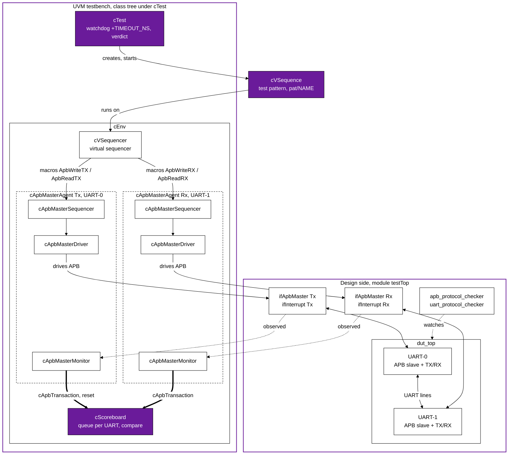

# UvmEnvUartApb

UVM environment for a UART with an APB register interface. It contains the full set of UVM components (two APB master agents, monitors, scoreboard, virtual sequencer, tests), protocol checkers for APB and UART, a self-developed UART-APB IP core as DUT, and 15 test patterns. It is meant for studying and investigating UVM environments.

- Project: UVM environment for UART (Universal Asynchronous Receiver Transmitter)
- Authors: Pham Thanh Tram, Nguyen Sinh Ton, Doan Duc Hoang, Truong Cong Hoang Viet, Nguyen Hung Quan
- Page: VLSI Technology - https://nguyenquanicd.blogspot.com/
- UVM: Accellera UVM 2020.3.1 (IEEE 1800.2-2020) for the open-source flow; UVM 1.2 still works with Questa

## Layout

| Folder | Content |
|---|---|
| `dut/` | UART-APB IP core (Verilog) |
| `uvm_comp/` | UVM components: driver, monitor, agent, scoreboard, sequences, env, test |
| `checker/` | APB and UART protocol checkers |
| `pat/` | Test patterns. One directory = one test (`cVSequence.sv`) |
| `sim/` | Testbench top, Questa do-files |
| `scripts/` | `uartvip.py` (all tasks), `env_windows.ps1`, `env_linux.sh` |
| `Makefile` | Entry point of the tasks |
| `build/` | Generated output (git-ignored) |

## UVM environment structure

### Big picture

Two UART instances (`dut/dut_top.v`) are connected to each other: the TX pin of UART-0 drives the RX pin of UART-1 and the reverse. Each UART has its own APB register interface and its own clock. One APB master agent drives each interface. The scoreboard predicts what UART-1 must receive from what was written to UART-0 (and the reverse) and compares it with what is read back.

Colours: white, black and purple only. Purple boxes are the components that decide the verdict (`cTest`, `cScoreboard`) and the user's test pattern; thick arrows are the analysis ports to the scoreboard; dotted arrows are observation only.

The virtual sequencer `cVSequencer` is an ordinary `uvm_sequencer#(cApbTransaction)` with extra handles (`coApbMasterAgentTx`, `coApbMasterAgentRx`, `coScoreboard`). The test pattern runs on it and reaches the agent sequencers through `p_sequencer.coApbMasterAgentTx.coApbMasterSequencer` (and `...Rx...`), which is what the macros do.

### Components

| Class (file in `uvm_comp/`) | Base class | Role |
|---|---|---|
| `cTest` (`cTest.sv`) | `uvm_test` | Creates `cEnv` and the pattern `cVSequence`, starts the pattern on the virtual sequencer, runs a watchdog (`+TIMEOUT_NS`, default 100 ms of simulated time; a timeout is an error), prints `** TEST PASSED **` or `** TEST FAILED ** errors=N timeout=B` in `report_phase` |
| `cEnv` (`cEnv.sv`) | `uvm_env` | Builds two agents, the scoreboard and the virtual sequencer; connects the analysis ports |
| `cApbMasterAgent` (`cApbMasterAgent.sv`) | `uvm_agent` | One APB master: sequencer + driver + monitor. Always active. Two instances: `coApbMasterAgentTx` (UART-0) and `coApbMasterAgentRx` (UART-1) |
| `cApbMasterSequencer` | `uvm_sequencer#(cApbTransaction)` | Hands items from the sequences to the driver |
| `cApbMasterDriver` | `uvm_driver#(cApbTransaction)` | Converts an item into an APB transfer (see below) |
| `cApbMasterMonitor` | `uvm_monitor` | Observes the APB bus, the reset and the interrupt outputs (see below) |
| `cScoreboard` | `uvm_scoreboard` | Data checking between the two UARTs (see below) |
| `cVSequencer` | `uvm_sequencer#(cApbTransaction)` | Virtual sequencer, no behaviour of its own |
| `cVSequence` (`cVSequence.sv`) | `uvm_sequence` | Default (empty) test pattern. Each `pat/<name>/cVSequence.sv` replaces it |
| `cApbTransaction` | `uvm_sequence_item` | One APB transfer: `pwrite`, `paddr`, `pwdata`, `pstrb`, `prdata`, `pslverr`, `pready`, `apbDelay`, and the flags `apbSeqEn`/`apbConEn` |
| `cApbMasterWriteSeq`, `cApbMasterReadSeq`, `cApbMasterWriteSeqNotCmpr` (`cCommonSequence.sv`) | `uvm_sequence` | Building blocks used by the patterns: register write, register read with expected value and mask, register read without comparison |
| `uMacro.svh` | macros | `ApbWriteTX/RX`, `ApbReadTX/RX`, `ApbReadWoCmprRX`, `ApbWriteRandTX`: start a common sequence on the right agent in one line |
| `ifDut.sv` | interfaces | `ifApbMaster` (clock, reset and the APB signals), `ifInterrupt` (one combined interrupt, or five separate ones without `INTERRUPT_COM`), `ifUart` (declared, not used by the current testbench) |

### Driver, monitor and scoreboard in detail

**Driver (`cApbMasterDriver`).** After reset is released it loops: get an item, drive an APB write or read, `item_done`. Signals are driven with non-blocking assignments. SETUP phase (`psel=1`, `penable=0`), then ACCESS phase (`penable=1`), then the driver waits for `pready`, captures `prdata` and `pslverr` at the edge that ends the transfer, and drops `psel`/`penable`. If `pready` does not arrive within `cApbTransaction::APB_TRANSACTION_TIMEOUT` cycles it reports `APB TIMEOUT`. If reset is asserted during a transfer the transfer is abandoned, the sequencer handshake is closed (`item_done`) and the bus is idle until the reset is released.

**Monitor (`cApbMasterMonitor`).** Four tasks run in parallel in `run_phase`:

1. `collect_data` — sees every completed APB transfer (`psel && penable && pready`) and sends a **new copy** of the transaction (including `prdata` and `pslverr`) to `ap_toScoreboard`.
2. `detect_reset` — sends the value of `preset_n` to `preset_toScoreboard` when it changes.
3. `monitor_ifEn` — follows the interrupt enable register (write to offset `0x10`).
4. `detect_intf` — checks the interrupt outputs: an interrupt without its enable bit is an error, an enabled interrupt is only a warning with the reason (TX FIFO empty, RX FIFO full, overflow, parity error, frame error). The checks are skipped while the reset is active.

**Scoreboard (`cScoreboard`).** It receives the transactions of both monitors and the reset from the TX monitor. For each UART it tracks the enable bit (write to offset `0x04`, bit 0). A write to the data register (`0x0C`) of a UART that is enabled pushes the low 8 bits into that UART's queue; a read of the data register pops the oldest entry from the *other* UART's queue and compares it with `prdata[7:0]`. One function (`check_uart`) serves both directions.

| Message | Severity | Meaning |
|---|---|---|
| `SB INFO` | info | Compare passed |
| `SB ERROR` | error | Compare failed |
| `SB UNDERFLOW` | error | A read of data with nothing sent by the other UART |
| `SB UNFINISH-TX` / `SB UNFINISH-RX` | error | Data sent but never received at the end of the test |
| `SB RESET` | info | Reset seen, both queues and enable flags cleared |
| `SB SUMMARY` | info | Number of compares passed and failed |

### Connections

| From | To | Type |
|---|---|---|
| `coApbMasterAgentTx.coApbMasterMonitor.ap_toScoreboard` | `coScoreboard.aimp_frmMonitorTX` | analysis port (`cApbTransaction`) |
| `coApbMasterAgentRx.coApbMasterMonitor.ap_toScoreboard` | `coScoreboard.aimp_frmMonitorRX` | analysis port (`cApbTransaction`) |
| `coApbMasterAgentTx.coApbMasterMonitor.preset_toScoreboard` | `coScoreboard.aimp_resetfrmTX` | analysis port (`logic`) |
| driver `seq_item_port` | sequencer `seq_item_export` | inside each agent |
| `testTop` | agents (`coApbMasterAgentTx*`, `coApbMasterAgentRx*`) | `uvm_config_db`: virtual interfaces `vifApbMaster` and `vifInterrupt` |

### Test flow and test selection

1. `testTop` generates two asynchronous clocks (UART-0 period 50 ns, UART-1 period 86 ns) and one reset pulse at the start, instantiates the DUT, the two checker modules and the interfaces, stores the virtual interfaces in `uvm_config_db`, and calls `run_test()`.
2. `+UVM_TESTNAME=test_<pattern>` selects a test. `scripts/uartvip.py gen` writes `build/gen/tests.svh`: for each `pat/<name>/cVSequence.sv` a renamed copy of the pattern (a subclass of the default `cVSequence`, so a factory type override is legal) and a class `test_<name>` extending `cTest`. Its `build_phase` sets the type override `cVSequence` -> pattern before `cTest` creates the sequence. One executable therefore contains all tests.
3. `cTest.run_phase` raises an objection, starts the pattern on `cEnv.coVSequencer` in parallel with the watchdog, and drops the objection when the pattern finishes or the watchdog fires.
4. A pattern is a task `body()` that calls the macros: write registers (baud rate `0x08`, control `0x04`, data `0x0C`, interrupt enable `0x10`), poll the status register (`0x04`; the patterns test bit 6 as the receive-data flag) and read the data. The scoreboard compares the data without any code in the pattern.
5. `report_phase`: the scoreboard checks the leftover queues and prints its summary; the test counts `UVM_ERROR`/`UVM_FATAL` messages and prints the verdict.

### Outside UVM: DUT and checkers

| Path | Content |
|---|---|
| `dut/` | `dut_top.v` (two `uart_top` instances, cross-connected), `uart_top.v`, `uart_apb_if.v` (APB slave and register file), `uart_transmitter.v`, `uart_receiver.v`, `m_fpt_uart_wrapper.sv` (wrapper of `uart_top` with pad-style port names) |
| `checker/apb_protocol_checker*.sv` | APB protocol checker module (`APB_ERROR`/`APB_WARNING`/`APB_INFO`, selected by a define), bound in `testTop` |
| `checker/uart_protocol_checker*.sv` | UART line checker (bit timing, frame, parity, baud rate error) on the TX/RX wires |

The checkers are plain Verilog/SystemVerilog modules, independent of the UVM classes: a protocol error is reported even if no sequence reads the data.

### How to extend

- **New test:** add `pat/<name>/cVSequence.sv` (see [Tests](#tests)).
- **New common operation:** add a sequence class to `cCommonSequence.sv` and a macro to `uMacro.svh`.
- **New check on the data path:** extend `cScoreboard.check_uart`. It currently models 8-bit data only (see [Known limitations](#known-limitations)).
- **New monitor feature:** add a task to `cApbMasterMonitor.run_phase` and send results through a new analysis port connected in `cEnv.connect_phase`.

## Quick start (open-source flow)

Needed: Python 3, GNU make, a C++ compiler, Verilator 5, UVM source. slang is optional (`make check`).

Windows (PowerShell, tools from OSS CAD Suite and MSYS2):

    . .\scripts\env_windows.ps1
    make doctor
    make fetch-uvm              # once: Accellera UVM 2020.3.1 into C:\Tools\uvm-core
    make check                  # type-check the testbench with the official UVM, seconds
    make build                  # compile once, a few minutes
    make regress                # every test

Linux:

    source scripts/env_linux.sh
    make doctor
    make fetch-uvm              # once: clones UVM 2020.3.1 into ~/uvm-core
    make check
    make build
    make regress

### Choosing the commands: `PLATFORM` and `SIM`

| Option | Values | Effect |
|---|---|---|
| `PLATFORM` | `auto` (default), `windows`, `linux` | Tool names (`verilator_bin.exe` or `verilator`), search paths, executable suffix, temporary directory |
| `SIM` | `verilator` (default), `questa` | Open-source simulator, or the Questa flow (`vlog`, `vsim`, `vcover`) |
| `PY` | `python3` | Python command; on Windows the Python of OSS CAD Suite is used when present |

    make regress PLATFORM=linux SIM=questa       # Questa on Linux
    make build PLATFORM=windows SIM=verilator

### Targets and options

| Target | Does |
|---|---|
| `doctor` | Platform, tools found, UVM version, number of tests |
| `lint` | Verilator and slang lint of the DUT and checkers |
| `check` | slang type-check of the full UVM testbench against the official UVM (no simulator; not a simulation) |
| `gen` | Writes `build/gen/tests.svh` (one `uvm_test` per pattern) |
| `build` | Compiles the testbench into one executable that contains every test |
| `run TEST=<pattern> SEED=<n>` | One test |
| `regress TESTS=all\|a,b SEEDS=1,2 JOBS=4` | Many tests in parallel, summary in `build/regress_summary.md` |
| `cov` | Merges coverage (build and run with `COV=1`) |
| `clean` | Removes `build/` |

Other options: `WAVE=1` (Verilator `wave.vcd`), `TIMEOUT_NS` (simulated time limit, default 100 ms), `WALL_TIMEOUT` (seconds per run), `UVM_HOME`.

A test passes only when it prints `** TEST PASSED **` and the simulator reports no error. A missing result line, an error, or a timeout is a failure, and the exit status of `make` follows.

## Tests

Each directory of `pat/` becomes the test `test_<directory name>` (for example `pat/baudrate_9600` is `test_baudrate_9600`). `make run TEST=baudrate_9600` takes the directory name. No file is copied or modified to select a test. A directory with a `SKIP` file is left out; the file says why.

To create a test: add `pat/<name>/cVSequence.sv` with the class `cVSequence` (copy `pat/trialPat` and edit). The macros of `uvm_comp/uMacro.svh` read and write UART registers through the common sequences of `uvm_comp/cCommonSequence.sv`.

Questa GUI: `cd sim`, then `do run_sim.do` (set `UVM_SRC` to the UVM `src` directory first).

## Baud rate and clocks

UART-0 (TX) and UART-1 (RX) have two different clocks (`sim/testTop.sv`). Use the frequency of the right UART in the formula `BaudRate = f_UART / (16 x (BRG + 1))`, with `BRG` the value of the baud rate register.

## Fixes in this version

| # | Where | Problem | Fix |
|---|---|---|---|
| 1 | `cApbMasterDriver.sv` | ACCESS phase always one cycle, no wait for `pready`; `prdata`/`pslverr` read before the clock edge that ends the transfer; signals driven with blocking assignments at the clock edge (race with the DUT) | Non-blocking drive; wait for `pready` with a timeout (`APB TIMEOUT` error); sample at the closing edge; a reset in the middle of a transfer returns the sequencer handshake |
| 2 | `cScoreboard.sv` | RX path wrote the expected data to the TX variable; queue read before the emptiness check; unsent data only a warning; reset cleared one queue | One checking function for TX and RX; check first; `SB UNDERFLOW` and `SB UNFINISH` are errors; reset clears both queues and flags; compare counters |
| 3 | `cTest.sv` | Timeout was a warning, so a hung test still ended as passed; no verdict | Timeout is an error (`+TIMEOUT_NS`); prints `** TEST PASSED **` or `** TEST FAILED **` |
| 4 | `cApbMasterMonitor.sv` | One transaction object written to the scoreboard again and again; `pslverr` not captured; `#1ps` after the clock edge; reset sent every cycle; wrong message IDs | A new transaction per transfer with `pslverr`; sampling at the clock edge; reset sent when it changes; IDs corrected |

Also changed so the open-source flow works: the three sequences assign their fields directly instead of `randomize() with {...}` on a fully constrained item (it needed a constraint solver per APB transfer; `pstrb` of a read is now 0); directories of `pat/` with spaces were renamed; the Questa scripts no longer contain absolute paths or copy files.

## Known limitations

- `pat/9Bit8BitDataAnd1OddParityTransferRandomSequencially` is excluded (`SKIP`): it does not compile.
- The scoreboard compares the 8 LSB bits only and does not model FIFO depth, parity, or 9-bit frames.
- The class `cApbMasterWriteSeqNotCmpr` is the read-without-compare sequence (the name is misleading and kept because patterns use it).
- There is no functional coverage model and no register model yet.
- The Questa flow was not run in this environment.
